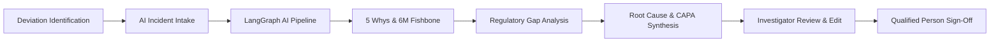

# AURA-QMS • AI-Powered Root Cause Analysis (RCA) & CAPA Suite
### Active Pharmaceutical Ingredients (API) Quality Operations

An enterprise-grade, cGMP-compliant Root Cause Analysis (RCA) and CAPA recommendation platform designed specifically for pharmaceutical manufacturers producing **Active Pharmaceutical Ingredients (API)** under FDA 21 CFR Part 211, ICH Q7, ICH Q9 (Quality Risk Management), and ICH Q10 (Pharmaceutical Quality System) regulations.

---

## 1. System Architecture & Tech Stack

- **Frontend**: **React 19** + **Redux Toolkit** + **Vanilla CSS Design System** (Ultra-sleek Dark Pharma Lab UI, interactive SVG Ishikawa 6M diagram, 5 Whys visual causal tree, side-by-side AI Copilot drawer, and 21 CFR Part 11 electronic sign-off).
- **Backend**: **Python 3.13** + **FastAPI** + **SQLAlchemy** + **Pydantic v2** + **PyPDF**.
- **AI Engine**: **LangGraph** (multi-node state graph) + **Groq** (`openai/gpt-oss-120b`, `qwen/qwen3.8-27b`, `llama-3.3-70b-versatile`).
- **Database**: Dual-engine support for **PostgreSQL** / **MySQL** with automatic fallback to **SQLite** (`rca_pharma.db`) for immediate zero-config execution.

---

## 2. End-to-End Pharmaceutical Quality Workflow



### Phase 1: Deviation Intake & Processing
- Ingests quality deviations via **PDF document upload**, **pasted incident logs**, **QC email alerts**, or **built-in API Pharma Presets**.
- Automatic extraction of critical fields: Investigation Title, API Product Name, Batch/Lot Number, Manufacturing Unit, Process Stage, Deviation Severity (Critical / Major / Minor), and Immediate Containment Actions.

### Phase 2: Root Cause Analysis (RCA)
- **5 Whys Causal Deduction**: Iterative causal progression moving from physical symptoms (e.g., crystallization temperature stall) down to systemic equipment maintenance or engineering design deficiencies.
- **Ishikawa 6M Framework**: Visual SVG diagram categorizing causes across **Machine**, **Method (SOP)**, **Milieu (Cleanroom/HVAC)**, **Man (Personnel)**, **Material (Solvents/Reagents)**, and **Measurement (Analytical/Sensors)**.

### Phase 3: Regulatory Evidence & Gap Analysis
- Evaluates attached verified evidence (SCADA historian trends, HPLC chromatograms, BMR logs) against FDA cGMP expectations.
- Flags **critical information gaps** (e.g., missing RTD sensor metrology calibration certificates, unverified supplier COAs).

### Phase 4: CAPA Recommendations & Effectiveness Criteria
- Synthesizes primary root cause with an **AI Confidence Score** (e.g. 94.5%) and scientific rationale.
- Generates 3-tiered CAPA action plan:
  1. **Immediate Containment**: Quarantine affected batch, ERP digital inventory blocks.
  2. **Corrective Action (CA)**: Overhaul worn mechanical seals, re-pressure test reactor.
  3. **Preventive Action (PA)**: Revise PM schedules from 180 to 90 days, configure automated SCADA barrier fluid pressure alarm interlocks.
- Sets objective, quantifiable **Effectiveness Check Criteria** (e.g., 3 consecutive validation batches showing < 0.05% Impurity-C).

### Phase 5: Qualified Person (QP) Sign-Off & Audit Trail
- FDA 21 CFR Part 11 compliant electronic signature and time-stamped audit logging.
- Printable/exportable **Regulatory Investigation Report Preview** for FDA / EMA audit inspections.

---

## 3. How to Run the Application

### Prerequisites
- Node.js (v18+) and npm
- Python (3.10+)

### Backend Setup
```bash
cd backend

# Environment configuration is pre-configured in .env
# Start the FastAPI server (runs on http://127.0.0.1:8000):
python -m uvicorn app.main:app --host 127.0.0.1 --port 8000 --reload
```

### Frontend Setup
```bash
cd frontend

# Install dependencies
npm install

# Start the Vite development server (runs on http://127.0.0.1:5173):
npm run dev -- --host 127.0.0.1 --port 5173
```

---

## 4. Pre-Loaded Pharma API Presets for Quick Demo

1. **Preset 1 (Crystallization & Synthesis)**:
   *Atorvastatin Calcium Trihydrate API* — OOS Impurity-C Spike during final crystallization due to reactor mechanical seal glycol micro-leakage and 180-day PM interval lag.
2. **Preset 2 (Vacuum Cone Drying)**:
   *Metformin Hydrochloride API* — Residual solvent (Isopropanol) excursion exceeding ICH Q3C limits (6,850 ppm vs 5,000 ppm) due to vacuum filter bag cake blinding.
3. **Preset 3 (Isolation & Centrifugation)**:
   *Ciprofloxacin HCl API* — Extraneous black particulate contamination during basket centrifugation due to PTFE scraper knife misalignment.

---

## 5. Submission Video Guide

### Video 1: Product Demonstration (5–8 minutes)
- **Introduction**: Briefly introduce AURA-QMS as an AI-powered RCA module for API pharmaceutical manufacturing.
- **Intake Flow**: Open the AI Copilot Drawer, show the preset / text / document input, and click **Run AI Root Cause Analysis**.
- **Live Pipeline**: Point out the LangGraph 5-node stepper animating as it processes the deviation.
- **Form Population**: Show the suggestions deck with confidence score, and click **Populate All** (or populate individual cards).
- **Interactive Investigation Review**:
  - Walk through **Tab 1 (Intake)**, show editable fields and containment actions.
  - Walk through **Tab 2 (5 Whys)**, show causal progression, edit an answer, and explain Step 5 root cause.
  - Walk through **Tab 3 (Ishikawa 6M)**, show the interactive SVG fishbone diagram and factor verification matrix.
  - Walk through **Tab 4 (Evidence Gaps)**, explain why highlighting missing evidence is critical for FDA audits, and resolve a gap.
  - Walk through **Tab 5 (Root Cause & CAPA)**, show confidence meter, primary cause rationale, and quantifiable effectiveness check metrics.
- **Regulatory Execution**:
  - Click **QP Sign-off**, check the 21 CFR Part 11 certification box, execute signature, and show the celebration/verified seal.
  - Click **Export Audit PDF** to showcase the formal regulatory report ready for FDA inspection.

### Video 2: Technical Walkthrough & Code Explanation (5–10 minutes)
- **Frontend Architecture**: Walk through Redux Toolkit (`investigationSlice.js`), React components, and the Vanilla CSS design system.
- **Backend API & Database**: Explain `backend/app/main.py`, FastAPI routers (`investigations.py`, `ai_analysis.py`), and SQLAlchemy models with PostgreSQL/MySQL/SQLite support.
- **LangGraph & Groq Engine**: Open `backend/app/ai/workflow.py`, explain the 5 discrete nodes (`extract_deviation_node`, `generate_five_whys_node`, `generate_fishbone_node`, `evaluate_evidence_gaps_node`, `synthesize_root_cause_and_capa_node`), state passing, and Groq fallback logic (`groq_client.py`).
- **Pharma Domain Rigor**: Explain the compliance principles embedded in the system prompts (`prompts.py`) aligning with ICH Q7, Q9, Q10, and FDA 21 CFR Part 211.
